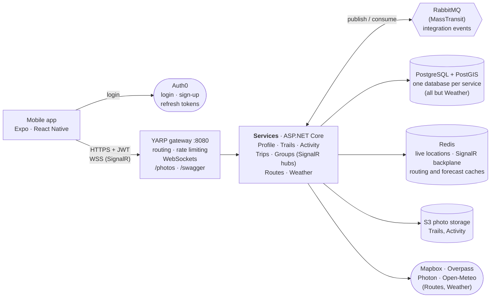
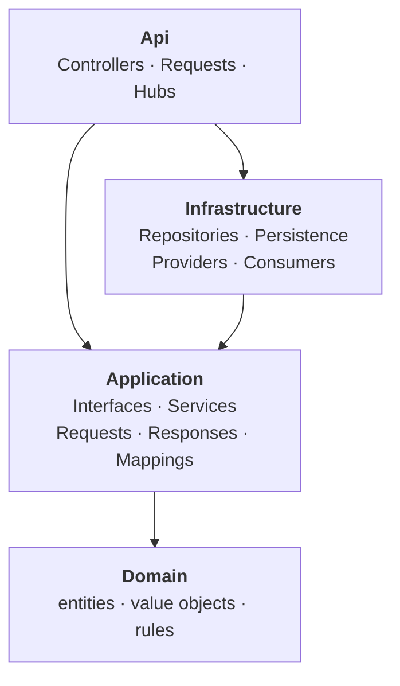
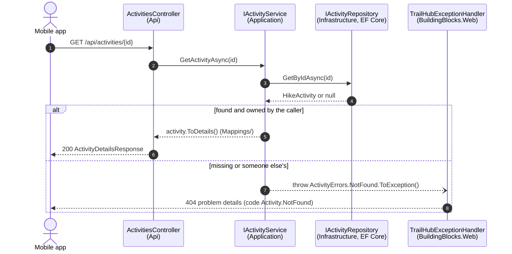
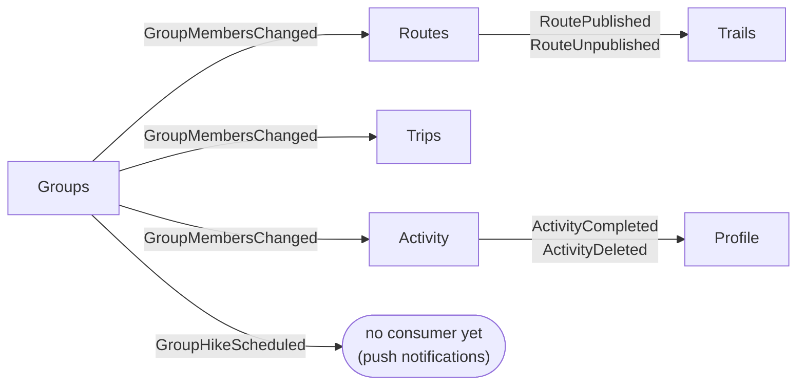

# TrailHub

[](https://github.com/RokasKam/TrailHub/actions/workflows/ci.yml)

A hiking app. Discover trails, plan routes and multi-day itineraries on a map, record hikes with GPS (offline-first),
plan trips alone or with a group, hike together with live location, share hikes with your groups, and check mountain
weather.

```
mobile/    Expo (React Native) app · Expo Router · TanStack Query · Zustand · Mapbox · Auth0 · SignalR
backend/   .NET 10 microservices · PostgreSQL/PostGIS · Redis · RabbitMQ (MassTransit) · S3 photos · YARP gateway
scripts/   use-auth0.sh: writes the Auth0 settings for backend and mobile
.github/   CI (build, tests, end-to-end against the Docker stack) and CD (container images to GHCR)
```

**Contents:** [Features](#features) · [Architecture](#architecture) · [Backend code structure](#backend-code-structure) ·
[Services](#services) · [Events between services](#events-between-services) · [Mobile code structure](#mobile-code-structure) ·
[Testing and CI/CD](#testing-and-cicd) · [Run it locally](#run-it-locally) · [Auth0 setup](#auth0-setup) ·
[Offline behaviour](#offline-behaviour) · [Group location sharing](#group-location-sharing)

## Features

| Area | What you can do |
|------|-----------------|
| **Discover** | Search trails by text, near you, in a map area, or by difficulty, distance, gain and duration. Trail pages show the map, elevation profile, points of interest, photos, reviews, current conditions and a 3-day weather outlook. Favourite trails, import or export GPX, save trails offline. |
| **Plan** | Draw routes on a map: waypoints snap to walking paths (Mapbox Directions), with distance, ascent, walking time (DIN 33466), elevation profile and nearby water, huts, campsites and viewpoints. The multi-day planner splits a route into daily stages around overnight stops. Routes can be shared with groups, copied, exported as GPX, saved offline and published to Discover. |
| **Record** | GPS recording in the background with pause/resume, following a planned route or one day of it. It works without signal; finished hikes upload when you're back online. |
| **Hikes** | Your history and statistics (this year, all time, last 12 months). **Feed**: hikes your groups shared, with likes, comments and photos. |
| **Share a hike** | After a hike, share it with some of your groups, with a caption, up to 6 photos and track privacy (full map, hide the first and last 200 m, or stats only). |
| **Trips** | Multi-day trips with a plan per day, overnight stops, an attached route, and a packing checklist. Group trips sync live between members, who can claim group items. **Gear lists**: reusable packing lists, starter lists, and suggestions based on the trip (huts, tent nights, altitude, long days). |
| **Groups** | Invite codes, scheduled group hikes with RSVPs and meeting points, and live location on a shared map. |
| **Moderation** | Report trails, trail photos, hike photos and comments. Three reports hide an item until a moderator reviews it. Moderators get a queue with Restore, Hide and Delete. |
| **Profile** | Profile, units and map preferences, hiking totals and achievements. |

## Architecture



- **Each service owns its data.** Every service has its own database (`trailhub_trips`, `trailhub_trails`, …) on the
  Postgres server, and no service reads another's tables. Services only share integration events (`TrailHub.Contracts`). When a service needs another
  service's data, it keeps a small read model fed by events. For example, Trips, Routes and Activity each keep a copy
  of group membership.
- **Gateway.** The gateway (YARP) is the only public entry point. It routes `/api/{service}/…` and `/hubs/…` to the
  services, serves photos from S3 at `/photos/…`, and shows one Swagger UI for all services at `/swagger`.
- **Auth.** Every service validates the Auth0 JWT itself (issuer, audience, lifetime); the user id everywhere is the
  `sub` claim. `AUTH_MODE=Development` swaps Auth0 for `Authorization: Dev <user-id>`, which the tests and local
  experiments use.
- **Errors** are RFC 9457 problem details everywhere: `status`, `title` = error code (e.g. `Trip.NotFound`), `detail` = a
  message the app can show, plus a `code` extension.

## Backend code structure

```
backend/
  src/
    Gateway/TrailHub.Gateway/              YARP reverse proxy, rate limiting, Swagger UI, /photos
    BuildingBlocks/                        shared kernels (no service-specific code)
      TrailHub.BuildingBlocks.Domain/        Entity, AggregateRoot, Result/Error, Geo (GeoPoint, RouteMetrics, ElevationProfile)
      TrailHub.BuildingBlocks.Application/   ICurrentUser, IUnitOfWork, IEventPublisher, paging, GPX model,
                                             Exceptions/ (NotFound, BadRequest, Forbidden, Conflict, ServiceUnavailable)
      TrailHub.BuildingBlocks.Infrastructure/ EF Core + PostGIS helpers, MassTransit setup, GPX serializer
      TrailHub.BuildingBlocks.Web/           service defaults: auth, problem details, exception handler, Swagger, health
      TrailHub.Contracts/                    integration events, the only thing services share
    Services/<Service>/                    Profile, Trails, Activity, Trips, Groups, Routes, Weather
  tests/
    TrailHub.UnitTests/                    domain rules (one test class per file)
    TrailHub.ArchitectureTests/            layering and dependency rules (fail the build when broken)
  scripts/                                 end-to-end tests against the running stack (see Testing)
  infra/                                   Postgres init, SeaweedFS (S3) config, Auth0 action
  docker-compose.yml · Dockerfile · build.sh · Directory.Build.props · Directory.Packages.props
```

### One service: repository → service → controller

Every service has the same four projects. Arrows show project references; nothing points upward:



| Project | Folder | What goes there |
|---------|--------|-----------------|
| `TrailHub.<Service>.Api` | `Controllers/` | Thin controllers: take `IXService` in the constructor, return its result |
| | `Requests/` | API-only input, e.g. multipart forms with `IFormFile` |
| | `Hubs/` | SignalR hubs (Trips, Groups) |
| `TrailHub.<Service>.Infrastructure` | `Repositories/` | EF Core implementations of Application's repository interfaces |
| | `Persistence/` | `DbContext`, `Configurations/` (one per entity), `Migrations/` |
| | `Providers/`, `Consumers/`, … | HTTP clients (Mapbox, OSM, Open-Meteo), S3, Redis, MassTransit consumers |
| `TrailHub.<Service>.Application` | `Interfaces/Repository/` | `IXRepository` |
| | `Interfaces/Service/` | `IXService`: what controllers call |
| | `Interfaces/Providers/` | `IRouter`, `IPhotoStorage`, `IWeatherProvider`, … |
| | `Services/` | `XService`: the business logic |
| | `Requests/`, `Responses/`, `Dtos/`, `Mappings/` | Input and output models, and the mapping from domain objects |
| `TrailHub.<Service>.Domain` | | Entities, value objects and rules; no framework references |

A request flows like this, using `GET /api/activities/{id}` as the example:



- **Domain methods return `Result`**, with errors defined per service (`TripErrors`, `RouteErrors`, …). Services turn a
  failure into an exception with `error.ToException()`, `result.ThrowIfFailure()` or `result.GetValueOrThrow()`.
  `TrailHubExceptionHandler` maps each exception type to its HTTP status, so controllers never handle errors.
- **One type per file and no nested types.** Requests, responses, JSON shapes of third-party APIs and EF
  configurations each get their own file.
- **Architecture tests enforce the rules.** `tests/TrailHub.ArchitectureTests` fails the build if:
  - a layer or service references something it shouldn't;
  - a controller takes anything but a service interface;
  - a service or repository interface has no implementation in the right folder;
  - a type is nested;
  - an aggregate exposes a public setter.
- **Central configuration.** `Directory.Packages.props` pins package versions centrally. MassTransit is pinned to v8
  (Apache-2.0); v9+ needs a commercial licence. CI builds in Release with warnings as errors.

## Services

| Service | Owns | Storage | Talks to |
|---------|------|---------|----------|
| **Profile** | Profile, preferences, hiking totals, achievements | Postgres | consumes hike events |
| **Trails** | Trails, GPX import/export, points of interest, elevation profiles, favourites, reviews, condition reports, trail photos, trail and photo moderation | Postgres + **PostGIS** (GiST indexes for radius/area search, trigram indexes for text search, `jsonb` routes) · photos in **S3** | consumes route publish events |
| **Activity** | Recorded and imported hikes (segments, statistics, GPX export), **hike feed** (sharing, photos, likes, comments, track privacy), comment and hike photo moderation | Postgres + PostGIS (`multilinestring` per hike) · photos in S3 | publishes hike events; group membership read model |
| **Trips** | Multi-day trips, days and overnight stops, attached route, checklists (personal and group items with claims), gear lists and packing suggestions | Postgres · Redis (SignalR backplane) | group membership read model; live updates on `/hubs/trips` |
| **Groups** | Groups, invite codes, members, scheduled group hikes with RSVPs and meeting points, **live location** | Postgres · Redis (positions expire after 15 min; SignalR backplane) | publishes membership and group hike events; `/hubs/groups` |
| **Routes** | Route editor and multi-day planner: snapping, elevation, walking time, POIs, place search, name suggestions, alternatives, itinerary planner, sharing with groups, publishing to Discover | Postgres · Redis (routing, POI and elevation cache) | Mapbox (Directions, Terrain-DEM, Search Box, Tilequery) with OSM fallbacks (Overpass, Photon, Open-Meteo elevation) |
| **Weather** | Current conditions, 16-day forecasts adjusted to trail elevation, a hiking suitability rating per day | Redis cache only | Open-Meteo |

Each service is a separate ASP.NET Core app with its own Swagger document (`/swagger` on the service, or one combined UI
on the gateway). The backend serves 111 operations in all; `scripts/api-sweep.mjs` calls every one of them.

## Events between services



| Event | Published by | Consumed by | Why |
|-------|--------------|-------------|-----|
| `ActivityCompleted` | Activity, when a hike is recorded or imported | Profile | update totals, unlock achievements |
| `ActivityDeleted` | Activity | Profile | take the hike back out of the totals |
| `GroupMembersChanged` | Groups, on every membership change, and for every group when Groups starts | Trips, Routes, Activity | replace their copy of the group's members; it decides who can see group trips, shared routes and feed posts |
| `GroupHikeScheduled` | Groups | (none yet) | ready for push notifications |
| `RoutePublished` / `RouteUnpublished` | Routes | Trails | create, update or hide the Discover trail that has the route's id |

MassTransit queue names include the consumer's namespace, so each service gets its own queue and its own copy of every
event. Membership snapshots are processed one at a time, which prevents duplicate inserts when a group is created and
joined at once. A snapshot older than the one already applied is ignored. Failed messages retry with exponential
back-off.

## Mobile code structure

Expo SDK 58 with Expo Router (file-based routes), the React Compiler and the new architecture. It runs in a development
build (`expo run:*`), not Expo Go, because Mapbox, Auth0 and background location are native modules.

```
mobile/
  src/
    app/                      screens: every file is a route (Expo Router)
      _layout.tsx               root stack, auth gate, query client
      sign-in.tsx               welcome / Auth0 login
      (tabs)/                   native tab bar: Discover (index), Plan, Record, Hikes (activities), Profile
      trail/[id].tsx            trail page
      routes/[id].tsx           route editor (snapping, drag waypoints, undo, POIs, GPX, share, publish)
      routes/plan.tsx           multi-day planner (start, finish, days, accommodation → itinerary)
      activity/[id].tsx         one hike; activity/share.tsx: share sheet (modal)
      feed/[id].tsx             shared hike post with comments
      trips/, groups/, gear/    trips and checklists; groups and live map; gear lists
      moderation.tsx            moderator queue (Trails | Photos | Comments)
    api/                      TanStack Query hooks per area: trails, routes, planning, activities, feed, gear,
                              profile, live-location (SignalR)
    components/               ui.tsx (Screen, Card, Button, Chip, Segmented, Icon, …), trail-map.tsx (Mapbox),
                              charts, photo gallery and viewer, report sheet, share sheet, trip checklist and packing, …
    stores/                   Zustand: recording-store (active hike, saved to disk so it survives crashes),
                              sync-store (upload outbox, saved to disk), planner-store (last multi-day plan, memory only)
    location/                 background location tasks: hike recording, group location sharing
    auth/session.tsx          Auth0 session, token refresh, development-auth mode
    lib/                      api client (problem details → ApiError), query client and disk persistence,
                              shared types, icons (SF Symbol ↔ Material Symbol), formatting, geo helpers
    constants/theme.ts        colours, spacing, typography (light and dark)
  plugins/                    config plugin fixing Auth0 for SDK 58
  patches/                    patch-package fix for @rnmapbox/maps (map views were being recycled)
  app.config.ts               app config: Mapbox, Auth0, location, image picker, …
```

- **Server data** lives in TanStack Query. Most of it is saved to disk for 7 days so trails, routes and trips open
  offline. Social data (feed, posts, moderation queues) is never saved to disk. Only device state lives in Zustand:
  the hike being recorded, the upload outbox and the last multi-day plan.
- **Icons** are typed as `AppIcon` (`src/lib/icons.ts`). Each name maps an SF Symbol (iOS) to a Material Symbol
  (Android), and using an unmapped icon fails the type check.
- **Maps.** Mapbox draws every map. Trails and routes can be saved for offline use as Mapbox offline packs.
- **Real time.** SignalR pushes group trip changes and live locations.

## Testing and CI/CD

| What | Where | Runs |
|------|-------|------|
| Unit tests (domain rules: trails, hikes, trips, groups, routing, planner, gear, feed, moderation) | `backend/tests/TrailHub.UnitTests` | `./build.sh 'dotnet test TrailHub.slnx'` |
| Architecture tests (layering, dependencies, no nested types, controllers → services) | `backend/tests/TrailHub.ArchitectureTests` | same |
| Smoke test: 52 checks through the gateway | `backend/scripts/smoke-test.sh` | stack in `AUTH_MODE=Development` |
| Feature suites: SignalR, group trips, gear lists, hike feed, route sharing, moderation, content moderation | `backend/scripts/*-test.mjs` | `node scripts/<name>.mjs` |
| API sweep: calls every endpoint (111 operations), checks statuses and error shapes, fails if one is skipped | `backend/scripts/api-sweep.mjs` | `node scripts/api-sweep.mjs` |
| Mobile type check and lint | `mobile/` | `npx tsc --noEmit && npx expo lint` |

**CI** (`.github/workflows/ci.yml`) runs on every push and pull request in three jobs:
1. **Backend:** a Release build with warnings as errors, then the unit and architecture tests.
2. **Mobile:** type check and lint.
3. **End-to-end:** starts the whole Docker stack in development auth and runs every script above. Route-related suites
   need the `MAPBOX_ACCESS_TOKEN` repository secret.

**CD** (`.github/workflows/cd.yml`) runs after CI passes on `main`. It builds one container image per service plus the
gateway and pushes them to GHCR as `ghcr.io/<owner>/trailhub-<service>`.

## Run it locally

Requirements: Docker Desktop, Node 20+, Xcode and/or Android Studio. The .NET 10 SDK is optional:
`backend/build.sh` builds and tests inside the official SDK container.

### 1. Backend

```bash
cd backend
cp .env.example .env          # set AUTH_MODE=Development to try it without Auth0; add MAPBOX_ACCESS_TOKEN for routing
docker compose up -d --build  # gateway on http://localhost:8080
./scripts/smoke-test.sh       # needs AUTH_MODE=Development
```

**Swagger UI: http://localhost:8080/swagger.** Pick a service under *Select a definition*. To try requests, click
**Authorize** and paste an Auth0 access token (Dashboard → Applications → APIs → TrailHub API → **Test**). In
`AUTH_MODE=Development`, paste any user id instead.

Swagger is on in Development; set `Swagger__Enabled=true` to expose it elsewhere. Host ports are moved off the defaults
to avoid clashes: Postgres `55432`, Redis `56379`, RabbitMQ `55672` (UI `55673`), S3 `58333`.

- **Moderators:** set `MODERATOR_USER_ID` (an Auth0 `sub`) in `.env` to make one user a moderator in Trails and
  Activity.
- **Photos:** stored in SeaweedFS locally (dev credentials in `infra/seaweedfs/s3.json`). Production can use AWS S3,
  Cloudflare R2 or any S3-compatible store through `Photos__ServiceUrl` (omit it for AWS), `Photos__Bucket`,
  credentials (or an IAM role) and `Photos__PublicBaseUrl`. When testing on a physical phone, set
  `PHOTOS_PUBLIC_BASE_URL` to your computer's LAN address.
- **Routing:** `MAPBOX_ACCESS_TOKEN` turns on Mapbox routing, elevation, place search and POIs. Without it, routes
  are straight lines and the OSM services (Overpass, Photon, Open-Meteo elevation) fill in. `Routing__Provider` can
  also choose `OpenRouteService` (needs its own key; adds SAC trail grades) or `StraightLine`.

### 2. Mobile

```bash
cd mobile
cp .env.example .env.local    # API URL, auth mode, Auth0 + Mapbox values
npm start                     # Metro (also registers the Watchman watch)
npx expo run:ios              # or: npx expo run:android  (first build compiles the native modules)
```

- **After the first native build**, `npm start` is enough for JavaScript changes. New screen files need an app reload.
- **After changing `app.config.ts` plugins or permissions**, regenerate the native project before building:
  `npx expo prebuild -p ios` (`expo run:ios` doesn't redo this once `ios/` exists).
- **Android:**
  - Gradle needs Java 17+. If your default `JAVA_HOME` is older, prefix the build with
    `JAVA_HOME=/opt/homebrew/opt/openjdk@21/libexec/openjdk.jdk/Contents/Home`.
  - The emulator reaches your Mac's `localhost` through `adb reverse tcp:8080 tcp:8080` (and 8081, 58333).
    `expo run:android` sets up 8081.
  - Give the emulator at least 4 GB of RAM.

## Auth0 setup

1. **APIs → Create API**: identifier e.g. `https://api.trailhub.app` (this is the *audience*), signing RS256.
   Enable **Allow Offline Access** so the app gets refresh tokens.
2. **Applications → Create → Native**. Allowed Callback and Logout URLs (iOS and Android):
   ```
   trailhub.auth0://YOUR_DOMAIN/ios/app.trailhub.mobile/callback
   trailhub.auth0://YOUR_DOMAIN/android/app.trailhub.mobile/callback
   ```
   Under Advanced → Grant Types, keep *Authorization Code* and *Refresh Token*. Turn on
   **Refresh Token Rotation**.
3. **Actions → Library → Create Action** (Login / Post Login): paste
   [`backend/infra/auth0/add-profile-claims.js`](backend/infra/auth0/add-profile-claims.js), deploy it,
   and add it to the post-login trigger. It puts the user's name and email into the access token so
   new profiles get a real name.
4. Run `./scripts/use-auth0.sh <domain> <client-id> <audience>`. It writes:
   - `backend/.env`: `AUTH_MODE=Auth0`, `AUTH0_DOMAIN`, `AUTH0_AUDIENCE`
   - `mobile/.env.local`: `EXPO_PUBLIC_AUTH_MODE=auth0`, plus domain, client id and audience

   Then restart the backend and rebuild the dev client, because the domain is baked into the native callback config.

Registration, social logins, password reset and MFA all happen in Auth0 Universal Login. The SDK keeps the refresh
token in the Keychain/Keystore and renews access tokens transparently.

## Offline behaviour

- **Recording** runs fully on the device in a background location task. The track is saved after every GPS batch, so a
  crash or the OS killing the app doesn't lose it.
- **Uploads go through an outbox.** Finished hikes are sent with `PUT /api/activities/{client-generated id}`, so
  retries are idempotent. Uploads resume when connectivity returns, and a rejected upload is kept for the user.
- **Trails and planned routes** (details, routes, elevation, stats) are cached on disk for 7 days. **Save offline**
  also downloads Mapbox map tiles (zoom 10–15) around the route.

## Group location sharing

Members watch the live map over SignalR (`/hubs/groups`). Sharing your own position uses
`POST /api/groups/{id}/locations/mine` from a background location task (balanced accuracy, every 25 m or 30 s),
because a WebSocket doesn't survive the app being suspended. The server broadcasts each update to the group's live
map. Positions expire after 15 minutes, so a phone that goes quiet drops off. Sharing continues across app restarts
until you stop it or leave the group.

## Not built yet

- **Push notifications.** `GroupHikeScheduled` is already published; likes, comments and trip changes could use it
  too. It needs a notifications service with Expo Push (and an EAS project id).
- **Transactional outbox.** The MassTransit EF outbox would guarantee an event can't be lost between the database
  commit and publishing.
- **Android testing.** Android builds and runs, but only the sign-in screen has been checked.
